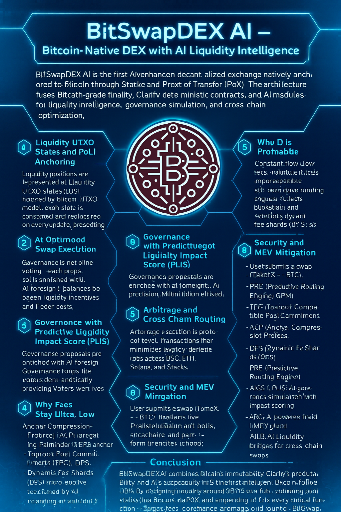

# AI-Powered Bitcoin-Native Exchange Architecture

<figure><figcaption></figcaption></figure>

BitSwapDEX AI — Bitcoin-Native DEX with AI Liquidity Intelligence

**BitSwapDEX AI** is the first AI-enhanced decentralized exchange natively anchored to Bitcoin through Stacks and Proof of Transfer (PoX). The architecture fuses **Bitcoin-grade finality**, **Clarity deterministic contracts**, and **AI modules** for liquidity intelligence, governance simulation, and cross-chain optimization.

The economic core is the **$BITS token**, designed as a _universal liquidity hub_ in a **hub-and-spoke model**. Instead of fragmenting liquidity across many trading pairs, all routes converge through $BITS toward BTC. A typical path is _TokenX → $BITS → BTC_, ensuring deeper liquidity and lower slippage. This model consolidates capital and enables micro-swaps directly to BTC without the need for hundreds of fragmented pairs.

### 1) Liquidity UTXO States and PoLI Anchoring

Liquidity positions are represented as **Liquidity UTXO States (LUS)**, inspired by Bitcoin’s UTXO model. Each state is consumed and replaced on every update, preventing replay and ensuring deterministic accounting. Snapshots of all LUS are batched into a Merkle tree root. The contract stores this root via a simple instruction like `'var-set merkle-root <32-bytes>'` and emits an `AnchorCommit` event with `'epoch: block-height'`.

Through PoX, the Merkle root is periodically committed to Bitcoin, forming **Proof-of-Liquidity Integrity (PoLI)**. This allows any LP or trader to verify pool states against Bitcoin’s finality using **Taproot-Compatible Pool Commitments (TPC)**, where Merkle roots are embedded inside Taproot script paths for compact proofs.

### 2) AI-Optimized Swap Execution

Every swap is influenced by the AI oracle. When a user calls `swap`, the contract retrieves reserves `'reserve-a, reserve-b'` from `'pool-state'`, queries the AI oracle with `'contract-call? 'SPaiOracle.fee-engine suggest-fee token-in amount reserve-a reserve-b'`, and computes a **Dynamic Fee Shard (DFS)**: `'final-fee = (/ (+ base-fee ai-fee) u2)'`. This final fee is written back with `'map-set pool-state {...} {reserve-a: (+ reserve-a amount), reserve-b: (- reserve-b final-fee), lp-fee: final-fee, last-update: block-height}'`.

The DFS mechanism ensures that fees adapt granularly to volatility, while the AI oracle balances between liquidity incentives and trader costs.

### 3) Governance with Predictive Liquidity Impact Score (PLIS)

Governance is not blind voting — each proposal is enriched with AI foresight. When a proposal is submitted, the contract calls `'impact = (contract-call? 'SPaiGovSim.predict-impact param)'`, attaches this **Predictive Liquidity Impact Score (PLIS)** to the proposal record `'proposals {id, title, param, status, plis}'`, and emits an event `'print {proposal: pid, ai-impact: impact}'`.

This way, voters do not just see text — they see the AI-predicted effect on liquidity depth, volatility, and risk before casting their vote.

### 4) Arbitrage and Cross-Chain Routing

BitSwapDEX AI integrates arbitrage as a protocol-level primitive. The arbitrage executor queries an AI pathfinder: `'SPaiArb.pathfinder find-path token-x token-y amount'`, logs `'print {arb-path: path, executor: tx-sender}'`, and finalizes `'ok {executed: true, path: path}'`.

Cross-chain swaps rely on **AI Liquidity Bridges (AILB)**. A router contract requests `'route = (contract-call? 'SPaiBridge.optimizer best-route origin target amount)'` and executes `'ok {status: "executed", route: route}'`. These routes minimize latency and bridge risks across BSC, ETH, Solana, and Stacks, with AI continuously retraining using Path Reinforcement Learning (PRL).

### 5) Why Fees Stay Ultra-Low

* **Anchor Compression Protocol (ACP):** thousands of swaps compressed into one PoX anchor.
* **Gas Prediction Models (GPM):** AI forecasts the optimal anchor timing with lowest Bitcoin fee rates.
* **Taproot Pool Commitments (TPC):** pool proofs compressed into Taproot script paths.
* **Dynamic Fee Shards (DFS):** micro-shard fees tuned by AI, balancing volatility and liquidity.

As a result, even sub-cent micro-swaps become sustainable, creating massive transaction throughput.

### 6) Why It Is Profitable

Low fees drive constant flow. AI spread harvesting introduces imperceptible basis-point margins on thin liquidity pools. Arbitrage executors profit from cross-chain spreads. LPs earn both DFS fees and **native BTC yield** via PoX staking of liquidity reserves. This combination compounds LP profitability while maintaining an attractive UX for retail traders.

### 7) Operational Flow (End-to-End)

1. User submits a `swap(TokenX → BTC)`.
2. PRE (Predictive Routing Engine) simulates thousands of routes and selects the lowest-cost path: _TokenX → $BITS → BTC_.
3. Inside `swap`, the AI oracle suggests a fee: `'ai-fee = (contract-call? 'SPaiOracle.fee-engine ...)'`.
4. The DFS final fee is computed and written back to `'pool-state'`.
5. The swap enters an ACP batch; the Merkle root `'var-set merkle-root root'` is committed and anchored in Bitcoin.
6. LPs receive dynamic DFS fees; arbitrage bots (PRL) capture cross-chain spreads.
7. Governance proposals for adjusting rewards are evaluated by AIGS, attaching a PLIS score for transparency.

### 8) Security and MEV Mitigation

The **AI Risk Guard (ARG)** continuously classifies transactions. If `'risk-score > threshold'`, contracts can trigger a _cool-off_ or require additional confirmations. PRE also batches swaps to reduce sandwich MEV, while ACP increases randomness in anchor batching.

### 9) Strategic Innovations (Glossary)

* **LUS (Liquidity UTXO States):** liquidity tracked like Bitcoin UTXOs.
* **PoLI (Proof-of-Liquidity Integrity):** Merkle roots of pool states anchored in Bitcoin.
* **TPC (Taproot-Compatible Pool Commitments):** compact proofs in Taproot script paths.
* **ACP (Anchor Compression Protocol):** batching thousands of swaps per anchor.
* **DFS (Dynamic Fee Shards):** AI-adaptive fee fragments.
* **PRE (Predictive Routing Engine):** AI simulation of optimal swap paths.
* **AIGS / PLIS:** AI governance simulation with impact scoring.
* **ARG:** AI-powered fraud/MEV guard.
* **AILB:** AI Liquidity Bridges for cross-chain swaps.
* **PRL (Path Reinforcement Learning):** AI retraining of arbitrage strategies.

***

#### Conclusion

BitSwapDEX AI combines **Bitcoin’s immutability**, **Clarity’s predictability**, and **AI’s adaptability** into the first **intelligent Bitcoin-native DEX**. By designing liquidity around $BITS as a hub, anchoring pool states into Bitcoin via PoX, and embedding AI into every critical function — swaps, fees, governance, arbitrage, and routing — BitSwapDEX AI delivers ultra-low fees, high profitability for LPs, and unmatched security. 
