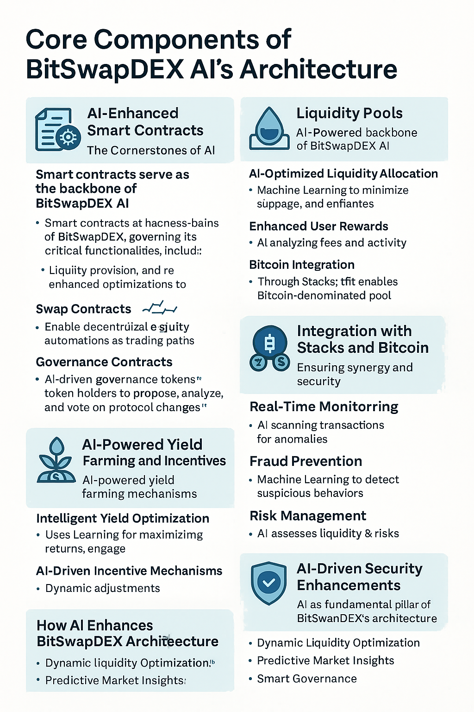

# Architecture BitSwapDEX AI - $BITS

#### **Advanced Architecture Overview: BitSwapDEX AI**

The architecture of **BitSwapDEX AI** is meticulously crafted to combine the capabilities of **Artificial Intelligence (AI)** with the unique strengths of the **Stacks blockchain** and the **Bitcoin network**. This synergy enables a **secure, efficient, and intelligent** decentralized finance (DeFi) experience that leverages Bitcoin's unparalleled security while introducing AI-driven functionalities for dynamic optimization and enhanced user interactions.

***

#### **Core Components of BitSwapDEX AI’s Architecture**

<figure><figcaption></figcaption></figure>

**1. AI-Enhanced Smart Contracts: The Cornerstones of BitSwapDEX AI**

Smart contracts serve as the backbone of BitSwapDEX AI, governing its critical functionalities, including **liquidity provision**, **asset swaps**, **governance**, and **reward distribution**. These contracts are fortified with **AI algorithms** to introduce real-time optimizations, enhancing transparency, security, and efficiency.

* **Liquidity Pool Contracts**:
  * Facilitate the **creation and management** of liquidity pools.
  * Leverage **AI-powered dynamic adjustments** to optimize liquidity allocation, reducing capital inefficiency and minimizing slippage.
  * Users receive **AI-optimized liquidity tokens** representing their stake, which can be used for governance or redeemed for the underlying assets.
* **Swap Contracts**:
  * Enable decentralized asset exchanges using an **AI-enhanced Automated Market Maker (AMM)** model.
  * AI dynamically determines pricing strategies and trading paths based on real-time data, ensuring **efficient and adaptive trading**.
  * This eliminates reliance on traditional order books, fostering a seamless and cost-effective experience.
* **Governance Contracts**:
  * AI-driven governance tools empower token holders to **propose**, **analyze**, and **vote** on protocol changes efficiently.
  * AI tools provide predictive insights on governance proposals, helping the community make data-informed decisions about fees, smart contract upgrades, and new token integrations.

***

**2. Liquidity Pools: The AI-Powered Backbone of BitSwapDEX AI**

Liquidity pools drive BitSwapDEX AI's decentralized trading, ensuring seamless and **efficient asset swaps** while rewarding liquidity providers (LPs). The integration of AI enhances liquidity pool operations by introducing:

* **AI-Optimized Liquidity Allocation**:
  * Machine Learning algorithms monitor trading patterns and liquidity flow in real time, dynamically reallocating assets to minimize **slippage** and optimize pool performance.
* **Enhanced User Rewards**:
  * AI mechanisms analyze trading fees and market activity to **distribute rewards intelligently**, maximizing LP incentives.
* **Bitcoin Integration**:
  * Utilizing **Stacks**, BitSwapDEX AI enables **Bitcoin-denominated liquidity pools**, facilitating direct BTC trading pairs.
  * AI tools further optimize yield opportunities in these Bitcoin-backed pools, ensuring both security and profitability.

***

**3. AI-Powered Yield Farming and Incentives**

BitSwapDEX AI introduces **yield farming mechanisms** that incentivize user participation while leveraging AI for efficient reward distribution and liquidity optimization:

* **Intelligent Yield Optimization**:
  * Machine Learning models predict optimal yield strategies, helping users maximize returns for providing liquidity or participating in governance.
* **AI-Driven Incentive Mechanisms**:
  * Incentives are dynamically adjusted based on platform activity, liquidity depth, and trading volume.
  * AI analyzes market trends to determine the most effective token rewards, ensuring a sustainable ecosystem.

***

#### **4. Integration with Stacks and Bitcoin: Ensuring Synergy and Security**

BitSwapDEX AI’s architecture integrates **Stacks blockchain** and **Bitcoin**, harnessing Bitcoin’s robust Proof-of-Work security model while enabling advanced smart contract functionalities. This integration is reinforced by AI to enhance performance and interoperability.

* **Proof of Transfer (PoX)**:
  * Stacks' PoX consensus mechanism connects Clarity smart contracts to Bitcoin's state, ensuring BitSwapDEX AI benefits from Bitcoin’s **immutability**, **decentralization**, and **security**.
  * AI tools analyze PoX patterns to improve synchronization and transaction efficiency.
* **Cross-Chain Mechanisms**:
  * BitSwapDEX AI utilizes Stacks’ cross-chain capabilities to facilitate:
    * **Direct BTC swaps** powered by AI-driven routing for optimal transaction efficiency.
    * **Bitcoin-based liquidity pools**, creating yield opportunities for BTC holders.
  * AI ensures seamless cross-chain communication by optimizing transaction speeds and reducing confirmation times.

***

#### **5. AI-Driven Security Enhancements**

Security is a fundamental pillar of BitSwapDEX AI’s architecture, reinforced by **AI-based anomaly detection** and predictive analytics:

* **Real-Time Monitoring**:
  * AI tools continuously scan transactions for irregularities or suspicious activity, ensuring platform integrity.
* **Fraud Prevention**:
  * Machine Learning models detect abnormal behavior and potential threats, proactively preventing attacks.
* **Risk Management**:
  * AI algorithms assess liquidity and trading risks, providing insights to optimize user decisions and system operations.

***

#### **How AI Enhances BitSwapDEX Architecture**

1. **Dynamic Liquidity Optimization**: AI adjusts liquidity pools based on real-time market data to reduce slippage and improve capital efficiency.
2. **Predictive Market Insights**: Machine Learning models analyze trading behaviors and market trends, offering actionable insights for traders and liquidity providers.
3. **Smart Governance**: AI tools support data-driven community proposals and decisions, fostering an inclusive and informed governance process.
4. **Enhanced Security**: AI monitors for threats, ensuring BitSwapDEX AI remains resistant to vulnerabilities and attacks.
5. **Cross-Chain Efficiency**: AI optimizes Bitcoin and Stacks transactions, facilitating a smooth and cost-effective DeFi experience.

***

#### **Conclusion**

The advanced architecture of **BitSwapDEX AI** combines the power of **AI-driven optimizations**, Bitcoin’s unmatched security, and Stacks’ smart contract capabilities to create a revolutionary decentralized exchange. By seamlessly integrating **Artificial Intelligence** into its core components—smart contracts, liquidity pools, and cross-chain mechanisms—BitSwapDEX AI delivers a **secure, efficient, and intelligent** DeFi platform.

This **AI-powered architecture** ensures:

* **Optimal performance** through predictive analytics and dynamic adjustments.
* **Enhanced user security** with AI-driven threat detection.
* **Cross-chain interoperability** for seamless Bitcoin and Stacks integration.

**BitSwapDEX AI** positions itself as a **trailblazer in decentralized finance**, leveraging AI to redefine how users trade, earn, and govern in a Bitcoin-centric ecosystem.

***

**BitSwapDEX AI**: **The Intelligent Future of DeFi – Secure, Optimized, and AI-Driven**.
