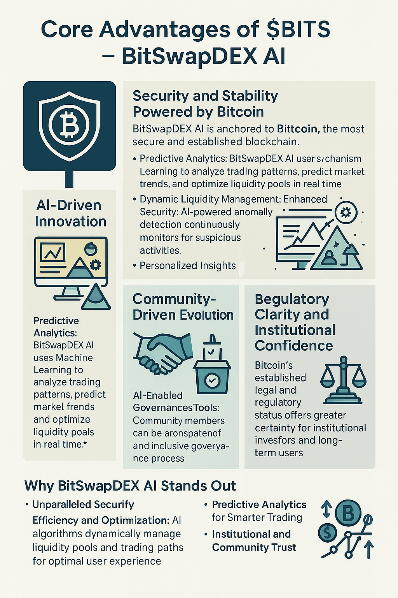

# DeFi  Problem Statement

#### **$BITS - BitSwapDEX AI: Problem Statement**

<figure><figcaption></figcaption></figure>

Decentralized exchanges (DEXs) have become a cornerstone of the decentralized finance (DeFi) ecosystem, enabling **transparent** and **permissionless** trading of digital assets. These platforms have revolutionized trading by eliminating intermediaries and fostering **peer-to-peer (P2P)** transactions. Among existing DEXs, **Uniswap** stands out as a pioneer on the Ethereum blockchain, achieving widespread adoption due to its intuitive interface and innovative **Automated Market Maker (AMM)** mechanism. By replacing traditional order books with liquidity pools, Uniswap has transformed asset trading and liquidity management.

Ethereum and other **Ethereum Virtual Machine (EVM)-compatible** blockchains have led the DeFi revolution, providing the flexibility and scalability needed for widespread application development. However, Ethereum is undergoing a critical transition from **Proof-of-Work (PoW)** to **Proof-of-Stake (PoS)**, aiming to improve scalability, energy efficiency, and network sustainability. While this shift presents opportunities, it also introduces challenges:

1. **Infrastructure Overhaul**: Extensive modifications to Ethereum's core infrastructure could lead to temporary disruptions.
2. **Security and Decentralization Risks**: PoS, while efficient, raises new considerations around validator concentration and potential vulnerabilities.
3. **Energy Efficiency Trade-offs**: Although PoS reduces energy usage, PoW remains unmatched for its proven reliability and resilience.

In this dynamic environment, **$BITS - BitSwapDEX AI** emerges as a **next-generation decentralized exchange** that leverages **Artificial Intelligence (AI)** while harnessing the inherent strengths of **Bitcoin**. By integrating AI-driven optimizations with Bitcoin’s unparalleled security and stability, **BitSwapDEX AI** introduces a **powerful alternative** for modern DeFi users.

***

#### **Core Advantages of $BITS - BitSwapDEX AI**

**1. Security and Stability Powered by Bitcoin**

* BitSwapDEX AI is anchored to **Bitcoin**, the most secure and established blockchain.
* Bitcoin's **Proof-of-Work (PoW)** consensus mechanism has stood the test of time, offering unmatched reliability and resistance to attacks.
* Through its integration with Bitcoin via the **Stacks blockchain**, BitSwapDEX AI ensures transactions are **secure**, **transparent**, and free from vulnerabilities common on less mature networks.

**2. AI-Driven Innovation**

* **Predictive Analytics**: BitSwapDEX AI uses **Machine Learning** to analyze trading patterns, predict market trends, and optimize liquidity pools in real time.
* **Dynamic Liquidity Management**: Leveraging AI algorithms, BitSwapDEX AI adjusts liquidity parameters to minimize slippage, enhance trading efficiency, and maximize returns for liquidity providers.
* **Enhanced Security**: AI-powered anomaly detection continuously monitors for suspicious activities, ensuring platform integrity.
* **Personalized Insights**: Traders receive AI-generated analytics and actionable insights to optimize their trading strategies.

***

**3. Community-Driven Evolution**

* Bitcoin’s **decentralized governance** model has fostered a strong, collaborative community. BitSwapDEX AI embraces this philosophy, ensuring decisions reflect **community consensus**.
* **AI-Enabled Governance Tools**: Community members can utilize AI-enhanced tools to propose, analyze, and vote on platform improvements, ensuring a transparent and inclusive governance process.

***

**4. Regulatory Clarity and Institutional Confidence**

* Bitcoin’s established legal and regulatory status offers **greater certainty** for institutional investors and long-term users.
* Compared to newer blockchain protocols, **Bitcoin's reputation** and global adoption provide a safer and more predictable environment for regulatory compliance.
* BitSwapDEX AI’s reliance on Bitcoin’s infrastructure instills confidence among institutional investors, encouraging broader DeFi participation.

***

**5. Cost-Efficiency and Scalability**

* BitSwapDEX AI minimizes transaction fees by leveraging **Bitcoin’s efficient infrastructure** through the **Stacks blockchain**.
* AI-driven optimizations enhance scalability, ensuring smooth and cost-effective trading experiences even during periods of high demand.
* Compared to Ethereum’s gas fees, BitSwapDEX AI offers a **cost-efficient alternative**, attracting users who seek to reduce trading costs without compromising on security.

***

#### **Why BitSwapDEX AI Stands Out**

While Ethereum’s PoS transition marks a significant step forward, it underscores the enduring importance of Bitcoin’s stability and PoW-based security. By combining **AI-driven innovations** with Bitcoin’s strengths, BitSwapDEX AI addresses the following critical needs of modern DeFi users:

1. **Unparalleled Security**: AI-enhanced tools and Bitcoin’s infrastructure ensure transactions are secure and tamper-proof.
2. **Efficiency and Optimization**: AI algorithms dynamically manage liquidity pools and trading paths for optimal user experience.
3. **Scalable DeFi Solutions**: Leveraging Bitcoin's infrastructure, BitSwapDEX AI provides a platform that scales efficiently while keeping transaction costs low.
4. **Predictive Analytics for Smarter Trading**: Machine Learning tools offer traders real-time insights, trend forecasts, and data-driven strategies.
5. **Institutional and Community Trust**: Combining Bitcoin’s regulatory clarity with a community-driven AI governance model ensures sustainable growth.

***

#### **Conclusion**

$BITS - BitSwapDEX AI represents the next evolution in decentralized exchanges. By integrating **Artificial Intelligence** and **Machine Learning** into its core systems, BitSwapDEX AI enhances trading efficiency, security, and scalability. Its foundation on **Bitcoin**—the most trusted and resilient blockchain—provides a level of stability and security unmatched in the current DeFi landscape.

In a world where Ethereum evolves, **BitSwapDEX AI** emerges as a unique solution that merges Bitcoin’s reliability with the power of **AI-driven optimizations**. This strategic approach positions BitSwapDEX AI as the **go-to platform for modern DeFi users**, offering security, efficiency, and intelligence in one comprehensive ecosystem.

***

**$BITS - BitSwapDEX AI**: **Smart, Secure, Scalable** – **The Future of AI-Driven Decentralized Trading**.
