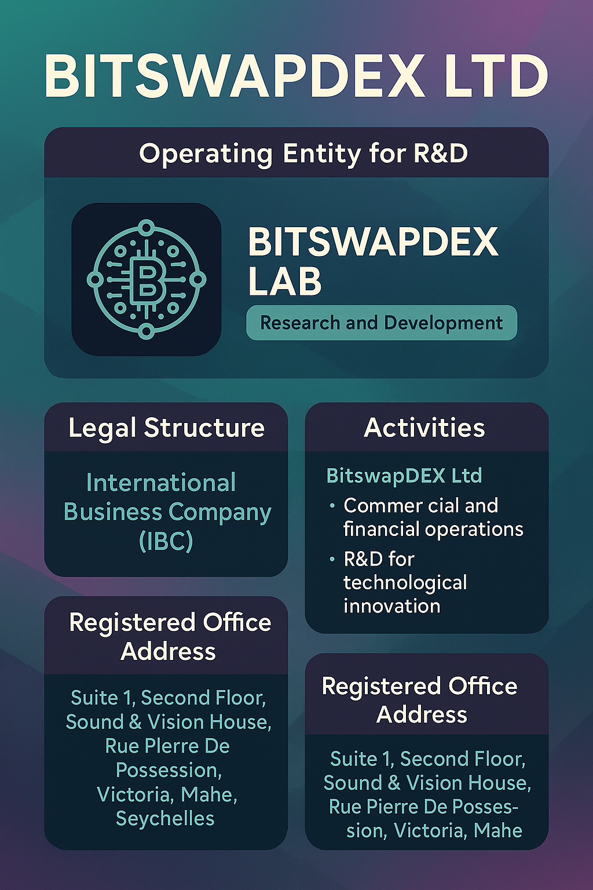

# Legal Structure & Compliance

## Legal Structure & Compliance

<figure><figcaption></figcaption></figure>

#### **Introduction**

BitswapDEX Ltd (operating under the research and development entity BitswapDEX LAB) is the legal structure responsible for the administration, management, and governance of the BitSwapDEX AI platform, including the issuance and management of the $BITS token. This section outlines the legal structure, regulatory framework, and compliance obligations under which BitswapDEX Ltd and BitswapDEX LAB operate.

***

#### **Legal Entity Information:**

* **Company Name:** BitswapDEX Ltd
* **Operating Entity for R\&D:** BitswapDEX LAB (Research and Development Division)
* **Legal Structure:** International Business Company (IBC)
* **Incorporation Number:** 240961
* **Jurisdiction:** Republic of Seychelles
* **Registered Office Address:**\
  Suite 1, Second Floor, Sound & Vision House,\
  Rue Pierre De Possession,\
  Victoria, Mahe, Seychelles.

***

#### **Corporate Purpose and Activities:**

BitswapDEX Ltd operates as the legal entity for commercial, financial, and operational activities, including the issuance and management of the $BITS token. Additionally, BitswapDEX LAB functions as a dedicated research and development division, focusing on technological innovation, AI integration, and algorithm optimization.

**BitswapDEX Ltd - Commercial and Financial Activities:**

* Development, deployment, and management of decentralized exchange platforms.
* Issuance and management of utility tokens, including $BITS.
* Execution of smart contracts and AI-powered trading systems.
* Provision of liquidity management solutions.
* Offering staking and governance mechanisms for $BITS holders.
* Engaging in partnerships, integrations, and strategic collaborations.

**BitswapDEX LAB - Research and Development Activities:**

* Development and optimization of AI-powered trading algorithms.
* Implementation of predictive analytics and anomaly detection systems.
* Research on advanced blockchain integration and cross-chain interoperability.
* Testing of experimental features and pilot projects prior to commercial deployment.

***

#### **Compliance with Seychelles Regulations:**

BitswapDEX Ltd and BitswapDEX LAB operate under the legal framework of the **International Corporate Service Providers Act, 2003**, and the **Anti-Money Laundering Act, 1996** of Seychelles. Both entities are required to adhere to the following regulations:

1. **Anti-Money Laundering (AML) and Know Your Customer (KYC) Compliance:**
   * BitswapDEX Ltd must verify the identities of all clients, investors, and business partners.
   * Identification documents, proof of address, and source of funds are required from all stakeholders to mitigate money laundering risks.
   * BitswapDEX LAB, as the R\&D division, is also subject to internal compliance checks to ensure data integrity and confidentiality.
2. **Record-Keeping and Reporting Obligations:**
   * BitswapDEX Ltd must maintain accurate and up-to-date records of:
     * Bank statements
     * Contracts and agreements
     * Invoices and receipts
     * Transaction history and financial reports
   * BitswapDEX LAB is responsible for maintaining records related to R\&D activities, testing results, and algorithmic developments.
   * All records must be maintained in Seychelles and submitted bi-annually to the registered office by:
     * July 31 (for the first half of the year)
     * January 31 (for the second half of the year)
3. **Annual Financial Statements:**
   * BitswapDEX Ltd is required to prepare and maintain annual financial statements, including a balance sheet and income statement.
   * BitswapDEX LAB’s financial records are consolidated under the parent entity, BitswapDEX Ltd.
   * Pure holding companies with annual revenue below **USD 3.5 million** are exempt from the financial summary requirement.

***

#### **Risk Management and Compliance Policy:**

BitswapDEX Ltd and BitswapDEX LAB have established a comprehensive compliance program to ensure adherence to regulatory standards. This includes:

* Periodic risk assessments to identify and mitigate financial and operational risks.
* Implementation of AI-powered monitoring systems to detect suspicious transactions.
* Strict adherence to data protection and privacy policies in compliance with Seychelles regulations.

***

#### **Corporate Governance and Accountability:**

* The governance structure of BitswapDEX Ltd includes a Board of Directors responsible for overseeing corporate strategy, financial management, and compliance.
* BitswapDEX LAB operates as a dedicated R\&D division, reporting to the Board of Directors of BitswapDEX Ltd.
* The Board is accountable for ensuring that all activities conducted by BitswapDEX Ltd and BitswapDEX LAB align with regulatory requirements and fiduciary responsibilities.

***

#### **Dispute Resolution and Legal Jurisdiction:**

* Any legal disputes arising out of or in connection with the activities of BitswapDEX Ltd or BitswapDEX LAB shall be resolved under the laws of Seychelles.
* The competent court for such disputes is the **Supreme Court of Seychelles**, located in Victoria, Mahe.

***

#### **Contact Information for Legal and Compliance Inquiries:**

For further inquiries regarding legal structure, compliance obligations, or corporate governance, please contact:

* **Legal and Compliance Department - BitswapDEX Ltd / BitswapDEX LAB**
* Email: "contact@bits-ai.io" [contact@bits-ai.io](mailto:contact@bits-ai.io) 
* Phone: **+1 213 438 9991**
* Mailing Address:\
  Suite 1, Second Floor, Sound & Vision House,\
  Rue Pierre De Possession,\
  Victoria, Mahe, Seychelles.

***

#### **Important Notice:**

All information provided in this section is subject to change based on regulatory updates, amendments to the company’s Articles of Association, or other significant business developments. Stakeholders are advised to regularly review this section for the latest updates regarding the legal structure and compliance framework of BitswapDEX Ltd and BitswapDEX LAB.
